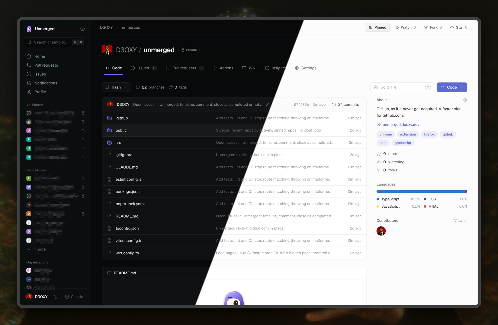

<p align="center">
  
</p>

<h1 align="center">Unmerged</h1>

<p align="center">
  GitHub, as if it never got acquired. A browser extension that re-skins github.com in place: same URLs,
  same session, a calmer Linear/Vercel/Raycast-style UI.
</p>

<p align="center">
  
</p>

## What it takes over

| Page | URL | Fallback |
|---|---|---|
| Home | `github.com/` (signed in) | Logged-out marketing page is left alone |
| Profile | `github.com/<user>`, `?tab=repositories`, `?tab=achievements`, `?tab=followers`, `?tab=following` | Stars and other `?tab=` views stay on GitHub |
| Organization | `github.com/<org>`, `/orgs/<org>/repositories`, `/orgs/<org>/people` | Teams, projects, packages and settings stay on GitHub |
| Pull request | `github.com/<owner>/<repo>/pull/<n>` plus `/commits`, `/checks`, `/files` | |
| Commit | `github.com/<owner>/<repo>/commit/<sha>`, `…/pull/<n>/commits/<sha>` | `.patch` / `.diff` and the commit's checks page stay on GitHub |
| Workflow run | `github.com/<owner>/<repo>/actions/runs/<id>` plus `/job/<id>` (steps and logs) and `/attempts/<n>` | The Actions tab and workflow pages stay on GitHub, and so do a running job's live logs |
| Compare & new pull request | `github.com/<owner>/<repo>/compare`, `…/compare/<base>...<head>` (a fork's head as `<user>:<branch>`), `?expand=1` | Two-dot (`..`) comparisons, `.patch` / `.diff` and a base in another repo stay on GitHub |
| Repository | `github.com/<owner>/<repo>`, `/tree/…`, `/blob/…`, `/commits/…`, `/issues`, `/pulls` (any `?q=` search) | Actions, Settings, etc. stay on GitHub |
| Issue | `github.com/<owner>/<repo>/issues/<n>`, `/issues/new` (template chooser, Markdown templates, `?title=`, `?body=`, `?labels=`, `?assignees=`) | Sub-issues and projects are only shown on GitHub; YAML issue forms (`?template=*.yml`) open GitHub's form |
| Pull requests & issues | `github.com/pulls`, `/pulls/assigned`, `/issues`, … (any `?q=` search) | |
| Notifications | `github.com/notifications` (inbox, unread, participating) | |

Every other page is untouched. Each page can be switched off from the toolbar popup, and **Classic** (sidebar
or ⌘K) shows the stock page for the current URL with a pill to come back.

In the issue and pull request lists, a row opens in a side panel next to the list (`?peek=<owner>/<repo>/issues/<n>`),
so you can go from one to the next without losing your place. The panel's expand button opens the page full
screen, Back closes it, and a new tab still gets the page itself. Turn it off under Lists in settings.

The theme follows GitHub's appearance setting by default; pick Light or Dark from the popup, the sidebar, or ⌘K.

## Install (dev)

```sh
pnpm install
pnpm build            # → .output/chrome-mv3
```

Chrome → `chrome://extensions` → Developer mode → **Load unpacked** → `.output/chrome-mv3`.
Click Unmerged's toolbar icon (or **Open Unmerged settings** on github.com) and paste a token (see below).
The token is only ever typed into the extension's own page, never into github.com.

`pnpm dev` runs WXT with hot reload in a separate browser profile. `pnpm build:firefox` builds for Firefox.

`pnpm check` runs everything CI runs except the Firefox build: `pnpm typecheck`, `pnpm test` (Vitest),
`pnpm lint` (ESLint), `pnpm build`, and the website's typecheck and build.

## Website

[unmerged.deoxy.dev](https://unmerged.deoxy.dev) lives in `site/`, a TanStack Start app in the same pnpm
workspace. `pnpm site` runs it on port 3000. `pnpm --filter site build` prerenders every page, so
`site/dist/client` is the whole site and can go on any static host.

## Token

The token is kept in the extension's storage (`chrome.storage.local`) and sent only to `api.github.com`.
Changing it or pressing **Disconnect** (popup → Change token) also deletes everything cached for the previous one.

**Classic token** (simplest, everything works):
[create one](https://github.com/settings/tokens/new?description=Unmerged&scopes=repo,read:org,read:user,user:follow,notifications)
with `repo`, `read:org`, `read:user`, `user:follow` and `notifications`. Classic tokens have no read-only scope
for private repos, so `repo` means full write access to them; if you only browse public code, `public_repo` in
its place is enough.

**Fine-grained token** (least privilege):
[create one](https://github.com/settings/personal-access-tokens/new) for the account or organization whose repos
you want, and pick only the repos and permissions for the features you use:

| Feature | Permission |
|---|---|
| Browsing repos, PRs, lists, home (always needed) | Repository → Metadata: read, Contents: read, Pull requests: read, Issues: read |
| Checks tab, workflow runs and job logs | Repository → Checks: read, Commit statuses: read, Actions: read |
| Open pull requests, comment, review, resolve threads, mark files viewed, close/reopen, draft/ready | Repository → Pull requests: read and write |
| Merge, auto-merge, merge queue, update branch, delete branch | Repository → Contents: read and write, Pull requests: read and write |
| Re-run failed checks or jobs | Repository → Actions: read and write |
| Star / unstar | Account → Starring: read and write |
| Watch | Account → Watching: read and write |
| Follow | Account → Followers: read and write |

Limits of fine-grained tokens: each covers one owner (your account or one organization; an organization may
need to approve it), so repos outside it don't show up; and the **Notifications** page doesn't work with them
(GitHub's notifications API only accepts classic tokens). Switch Notifications off in the popup if you use one.

## How it works

- A `document_start` content script hides GitHub's `<body>` for owned URLs before first paint and mounts a
  React app in a shadow root on `<html>` (so Turbo's body swaps can't remove it). Once GitHub's `<head>` has
  arrived (it says who's signed in), the rest of its page is stopped: none of its HTML body (~1 MB on a repo
  page) or scripts load underneath ours.
- Data comes from GitHub's GraphQL and REST APIs with your token.
- Links between owned pages swap in place (`pushState`), and so do GitHub links that point at them.
  Everything else is a normal page load. Back/forward onto owned pages is claimed before GitHub's router
  sees it.
- Keys aimed at GitHub's hidden page are swallowed so its hotkeys don't fire.
- A page's requests start as the script starts, before React or styles, and again when a link to it is
  hovered, focused or pressed, so most in-app navigations find their data already there. Slow GitHub queries
  are split into parallel requests (GitHub resolves one query's fields one after another).
- Results are cached in extension storage, per account, and shown at once on the next visit while the same
  request refreshes them. A result that comes back unchanged isn't written again, and a small index keeps the
  cache under 50 MB and a week old without reading the cache itself.
- Code is drawn by [`@pierre/diffs`](https://diffs.com) with Shiki (diffs and the file view). It lives in a
  separate script that pull request and repo pages load while idle, and each language's grammar loads on
  first use, so every other page pays nothing for it.

## Shortcuts

`⌘K` palette (commands, repo/people search, your PRs and issues by title, `owner/repo#123` jumps, or
just `#123` inside a repo) · `j`/`k` move between rows · `g h` home · `g p` your profile · `t` go to file
(repo pages) · `⌘↵` send comment · `?` every shortcut on the current page
